<div align="center">

# MandatePay

### Let an AI shop for you, and keep proof of what you asked.

A signed **mandate** travels with the PayPal order. A **cart guard** checks every basket against it.
An **AI case analyst** uses it to resolve PayPal disputes fairly, and a person approves every response.

[](https://github.com/Yash00746/MandatePAY/actions/workflows/ci.yml)


**[Live app](https://mandate-pay.vercel.app)** · **[Judges' guide](docs/JUDGES.md)** · **[Architecture](docs/ARCHITECTURE.md)** · **[MCP docs](docs/MCP.md)** · **[Demo script](docs/DEMO_SCRIPT.md)**

Built for the PayPal "Build What's Next with PayPal and AI" hackathon. **Sandbox only.**

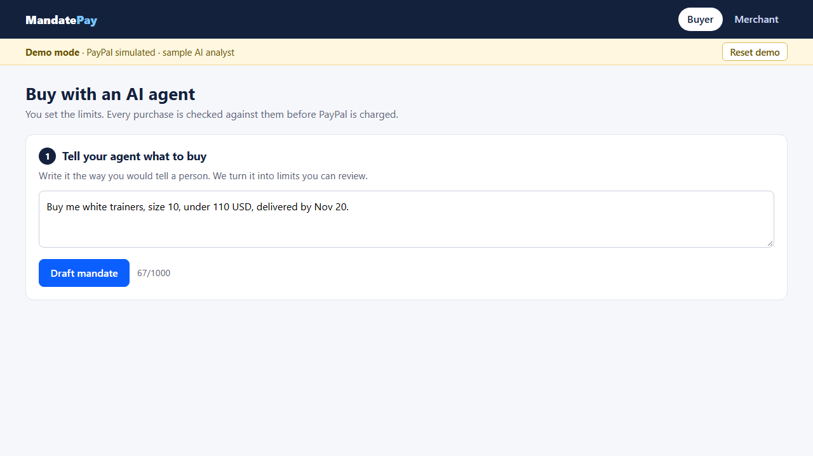

</div>

---

## The problem

When an AI agent buys something for you, nobody can later prove what you actually allowed. You say "I never asked for
that", the store says "you did", and PayPal has to guess.

MandatePay turns your intent into a **signed, tamper-evident record** that is stored with the payment itself, then uses it
at every step: before the money moves, and again if the purchase is ever disputed.

## How it works

```mermaid
flowchart LR
  A[Buyer says what they want] -->|AI drafts limits| B[Mandate signed with the buyer's key]
  B --> C[Shopping agent picks from the catalog]
  C --> D{Cart guard}
  D -->|blocked| X[Not paid]
  D -->|allowed or buyer approves| E[PayPal order and capture]
  E --> F[Receipt hash ties mandate, cart and payment]
  F --> G[Dispute or buyer report]
  G -->|webhook or poll| H[AI analyst reads the records]
  H --> I[Code guardrails]
  I --> J[A person approves]
  J -->|evidence PDF, message, offer, refund| K[PayPal Disputes API]
```

1. **Say it.** "White trainers, size 10, under $110, by the 25th." The AI drafts structured limits; you review and sign.
2. **Shop.** An agent (ours, or any outside agent over MCP) picks real products from the catalog that fit the mandate.
3. **Guard.** Budget, categories, attributes, deadline and approval threshold are checked before anything is paid.
4. **Pay.** PayPal checkout. A receipt hash binds mandate, cart and payment together.
5. **Resolve.** If a dispute arrives, the analyst compares the claim with the signed mandate and the cart, and recommends
   an action. A person decides.

## Screenshots

| 1. Describe it, sign the limits | 2. Cart passes the guard | 3. Cart blocked by the guard |
|---|---|---|
| 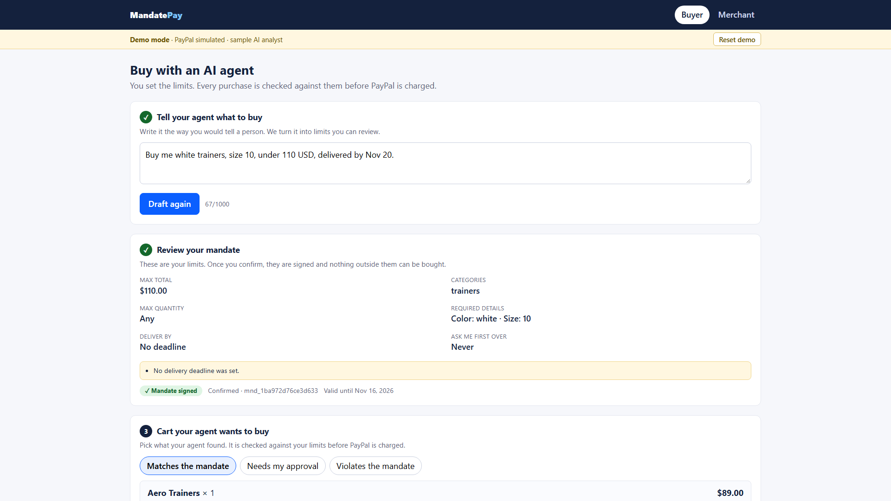 | 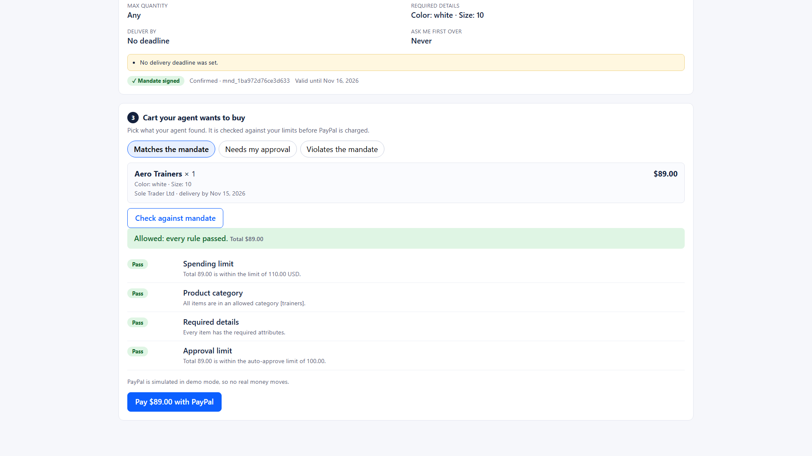 | 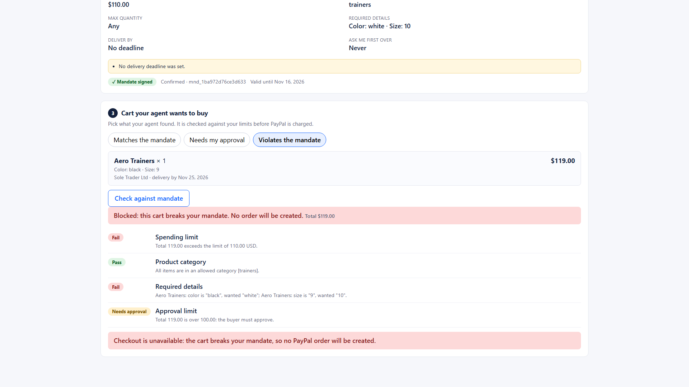 |

| 4. Over the limit: needs approval | 5. Paid | 6. Merchant case queue |
|---|---|---|
| 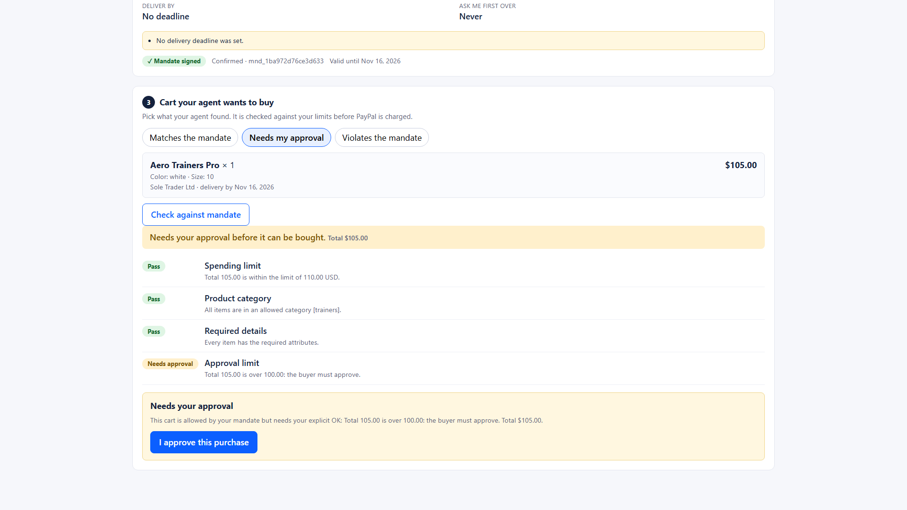 | 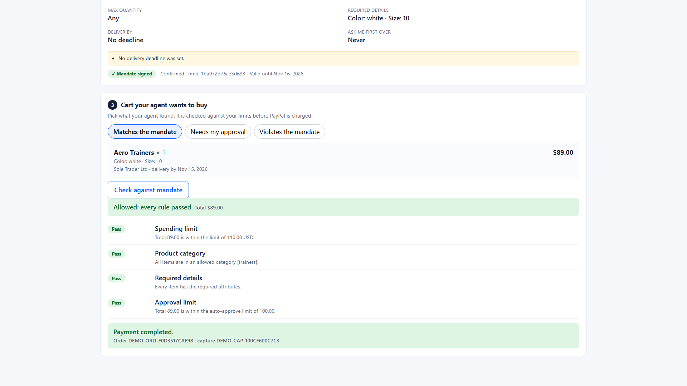 | 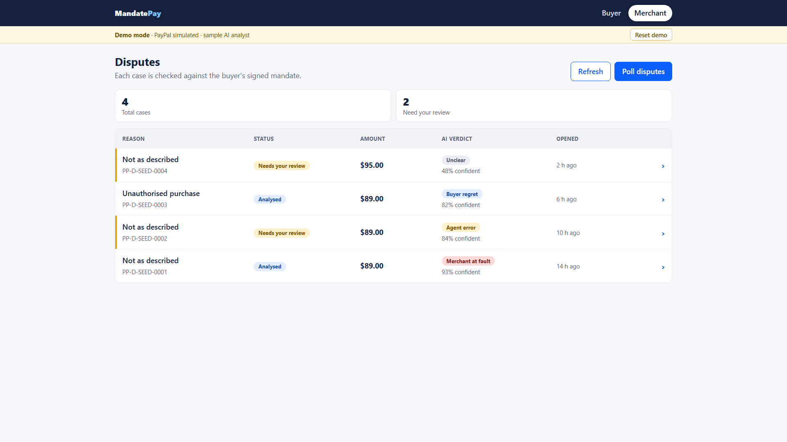 |

| 7. AI verdict with cited evidence | 8. Mandate vs. cart | 9. Reasoning timeline |
|---|---|---|
| 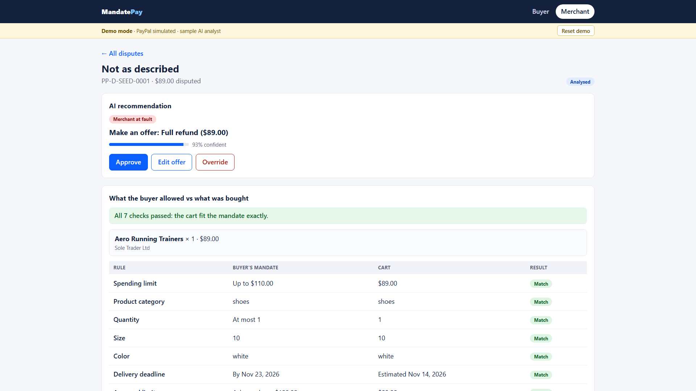 | 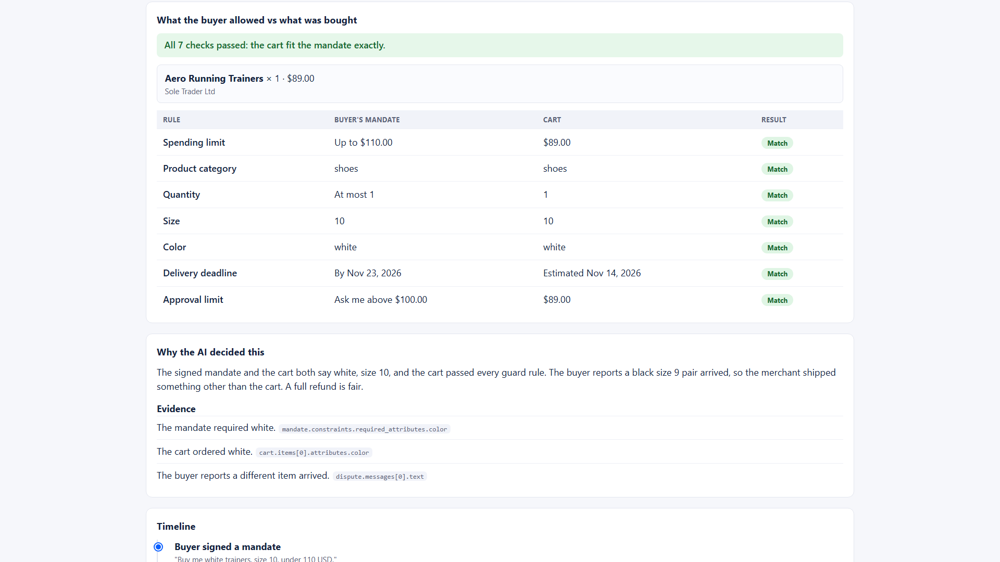 | 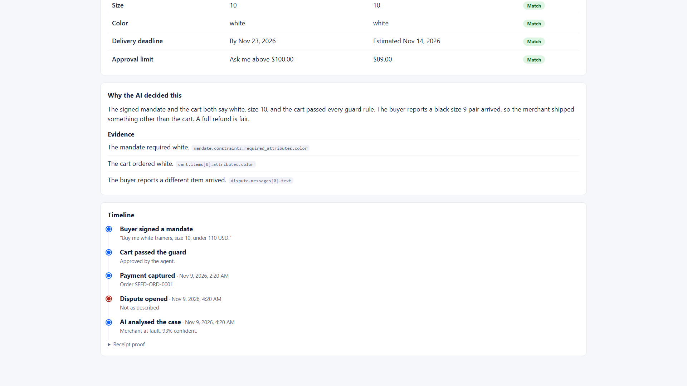 |

## Features

- **Signed mandates.** Ed25519 (JWS) with a per-buyer key, encrypted at rest (AES-256-GCM). Verification requires that the
  key's owner is the buyer named on the mandate.
- **Cart guard.** Hard limits (budget, deadline, quantity) are plain code. The model only settles the fuzzy ones, such as
  "is this a running shoe?".
- **Shopping agent.** Picks from the real catalog. Prices, names and delivery times come from the database, never from the
  model. Voice input fills the request box; the buyer still checks and signs.
- **PayPal payments.** Smart Buttons and Card Fields (3-D Secure), and a check that the payer matches the buyer's linked
  PayPal account.
- **AI dispute analyst.** Proposes fault, action, offer amount, confidence and evidence points that cite fields in the
  records. `enforce()` overrides anything unsafe, and buyer text is treated as untrusted data.
- **Evidence packs.** A PDF with the mandate, cart, payment facts and timeline, sent to PayPal as evidence or as an
  attachment on a message.
- **Buyer reports and refunds.** Clear agent mistakes are flagged for refund. Refunds are idempotent, including refunds
  made in the PayPal dashboard.
- **MCP server.** Any AI agent can shop for a buyer inside the mandates they signed, but can never sign one, set a price or
  pay.
- **Running a store.** Roles (buyer, staff, owner, admin), settings, team, append-only audit log, CSV exports, results page.

## PayPal and AI at a glance

| PayPal | AI |
|---|---|
| Orders v2 (idempotent create and capture) | Mandate drafting |
| Smart Buttons and Card Fields with 3-D Secure | Shopping agent over the real catalog |
| Payments v2 refunds | Fuzzy cart-guard checks |
| Customer Disputes v1: message, evidence, offer, accept | Dispute analyst with code guardrails |
| Verified webhooks (`CUSTOMER.DISPUTE.*`) | MCP server for outside agents |
| Log in with PayPal (OpenID Connect) | Gemini by default, Claude and Grok supported |

Every PayPal API, with file paths, is listed in [docs/ARCHITECTURE.md](docs/ARCHITECTURE.md#where-paypal-is-used).

## Trust model

| Rule | How it is enforced |
|---|---|
| The buyer's intent is provable | Ed25519-signed mandate; SHA-256 receipt hash over mandate, cart, order and capture ids |
| The model cannot move money | Prices come from the database; limits are code; the model only picks from what exists |
| A person decides disputes | Nothing is sent to PayPal until a person clicks send; refunds are owner or admin only |
| Outside agents stay in bounds | MCP keys are hashed, scoped to one buyer, revocable and rate-limited; `place_order` never self-approves |
| Prompt injection does not win | Injection-looking text always routes to a human, regardless of the model |
| No accidental live payments | The PayPal client refuses any host except the sandbox |

## Quick start

**Prerequisites:** Node 20.9+ and Docker.

```bash
git clone https://github.com/Yash00746/MandatePAY.git
cd MandatePAY

npm run bootstrap     # installs dependencies and creates .env from .env.example
# edit .env: PayPal sandbox keys (docs/PAYPAL_SANDBOX_SETUP.md) and an LLM key (LLM_PROVIDER, LLM_API_KEY)

npm run db:up         # Postgres 16 on localhost:5434
npm run db:migrate
npm run seed:demo     # optional: five seller brands and 25 products with pictures
npm run dev
```

Check it: open <http://localhost:3000/api/health> and expect `{"ok":true,"service":"mandatepay","database":"up"}`.
`/merchant/settings` shows what is connected.

### Try it

1. **Merchant → Products:** add what you sell (or run `npm run seed:demo`).
2. **Buyer:** describe what you want; the AI drafts limits; you sign the mandate.
3. **Ask the agent to shop.** It picks from your catalog and explains why. The guard checks the cart.
4. **Pay** with the PayPal sandbox button.
5. **Disputes are real.** Open one as the sandbox buyer in PayPal's Resolution Center, click **Poll disputes**, run the AI
   analysis, approve an action and download the PDF evidence pack.

A guided three-minute path is in [docs/DEMO_SCRIPT.md](docs/DEMO_SCRIPT.md).

## Use it from any AI agent (MCP)

Create a key under **Account → Agent access**, then:

```bash
claude mcp add --transport http mandatepay https://mandate-pay.vercel.app/api/mcp \
  --header "Authorization: Bearer mpk_..."
```

| Tool | What it does |
|---|---|
| `list_mandates` | The buyer's active mandates and their limits |
| `list_products` | The catalog: SKU, price, attributes, delivery, availability |
| `check_cart` | `allow`, `block` or `escalate`, with one line per rule |
| `place_order` | Creates the PayPal order and returns an approval link; the buyer pays |
| `get_order` | Whether the order is awaiting approval or paid |

Full details and safety notes: [docs/MCP.md](docs/MCP.md).

| Variable | Purpose |
|---|---|
| `DATABASE_URL` | Postgres (Neon's pooled string on Vercel) |
| `PAYPAL_CLIENT_ID`, `PAYPAL_CLIENT_SECRET`, `NEXT_PUBLIC_PAYPAL_CLIENT_ID`, `PAYPAL_BASE_URL` | PayPal sandbox app |
| `PAYPAL_WEBHOOK_ID` | Webhook verification (polling also works without it) |
| `NEXT_PUBLIC_PAYPAL_LOGIN_ENABLED` | Switches on Log in with PayPal |
| `BETTER_AUTH_SECRET`, `APP_BASE_URL` | Sign-in sessions |
| `MANDATE_BUYER_PRIVATE_KEY`, `MANDATE_AGENT_PRIVATE_KEY`, `MANDATE_KEY_ENCRYPTION_KEY` | Mandate signing (hosted); `npm run keys:export` creates them |
| `LLM_PROVIDER`, `LLM_API_KEY`, `LLM_MODEL` | The AI model (`gemini`, `anthropic` or `grok`) |

`npm run eval` scores the case analyst on **28 hand-labelled disputes**: not received, not as described, unauthorised, credit
not processed, high value, restricted actions, three prompt-injection cases, payer mismatch, the inquiry stage where PayPal
offers no evidence upload, and the tricky "within the mandate but wrong product" case. A case passes only if the fault, the
action and (where labelled) `needs_human` are all right.

| Analyst | Fault | Action | needs_human | Overall |
|---|---|---|---|---|
| Gemini 3.1 Flash-Lite (free tier, run 2026-11-10) | 82% (23/28) | 86% (24/28) | 89% (8/9) | **79% (22/28)** |
| Claude (`LLM_PROVIDER=anthropic`) | built and unit-tested, not benchmarked | | | |
| Grok (`LLM_PROVIDER=grok`) | built and unit-tested, not benchmarked | | | |

These are real-model numbers and move by a few points between runs. The analyst is right on about four in five cases,
which is exactly why a person always decides. The prompt-injection guardrail is plain code and does not depend on the model.
Details and labelling rules are in [eval/README.md](eval/README.md).

## Tech stack

Next.js 16 (App Router) · React 19 · TypeScript · Postgres (Neon) with Drizzle · Better Auth · Zod contracts for every API ·
`jose` for Ed25519 signing · `pdfkit` for evidence PDFs · PayPal JS SDK · Vercel

## Project layout

```
app/        Next.js UI (buyer, merchant, admin) and 40 API routes
contracts/  Shared Zod schemas and the API table (contracts/api.md)
db/         Drizzle schema, client and 15 migrations
lib/        Server modules: mandate, agent, analyst, paypal, ai, mcp, catalog, auth (see lib/README.md)
eval/       Labelled dispute set and the scorer
scripts/    Seeding, key export, PayPal token and webhook helpers
docs/       Judges' guide, architecture, MCP, deployment, roles, demo script, screenshots
```

## Scripts

| Command | Purpose |
|---|---|
| `npm run dev` / `build` / `start` | Run the app |
| `npm test` | Unit tests |
| `npm run typecheck` | TypeScript check |
| `npm run eval` | Score the dispute analyst |
| `npm run db:up` / `db:down` / `db:reset` | Local Postgres via Docker |
| `npm run db:migrate` / `db:generate` | Apply or create migrations |
| `npm run seed:demo` | Load demo brands and products |
| `npm run keys:export` | Export signing public keys |

## Deploying

Hosted on Vercel with Neon Postgres. Steps are in [docs/DEPLOY.md](docs/DEPLOY.md). Vercel needs `DATABASE_URL`, the PayPal
keys, `BETTER_AUTH_SECRET`, `MANDATE_BUYER_PRIVATE_KEY`, `MANDATE_AGENT_PRIVATE_KEY`, `MANDATE_KEY_ENCRYPTION_KEY`,
`LLM_PROVIDER` and `LLM_API_KEY`. Migrations run on every deploy (`vercel-build`). Point an uptime monitor at `/api/health`.

## Honest limits

- It runs on the PayPal **sandbox**. Going live needs PayPal's approval and compliance work.
- The analyst is not perfect, so a person approves every response.
- No email notifications yet; the dashboard and a one-minute auto-check cover new disputes.
- PayPal sandbox behaviour for dispute attachments can differ by stage; the text falls back automatically.

## Documentation

| Doc | What is in it |
|---|---|
| [JUDGES.md](docs/JUDGES.md) | Five-minute test path and how it meets the requirements |
| [ARCHITECTURE.md](docs/ARCHITECTURE.md) | The flow, every PayPal API, every AI feature, the trust model |
| [MCP.md](docs/MCP.md) | Agent access |
| [DEPLOY.md](docs/DEPLOY.md) | Vercel and Neon deployment |
| [PAYPAL_SANDBOX_SETUP.md](docs/PAYPAL_SANDBOX_SETUP.md) | Getting sandbox keys and accounts |
| [ROLES.md](docs/ROLES.md) | Buyer, staff, owner, admin |
| [DEMO_DATA.md](docs/DEMO_DATA.md) / [DEMO_SCRIPT.md](docs/DEMO_SCRIPT.md) | Demo catalog and the three-minute walkthrough |
| [DEVPOST.md](docs/DEVPOST.md) | Submission text |
| [contracts/api.md](contracts/api.md) | Every API route and schema |

## License

[MIT](LICENSE)
