# How MandatePay works

MandatePay lets a person give an AI shopping agent **signed spending limits**, checks every cart against them, takes the
payment through **PayPal**, and uses the signed record plus an **AI dispute analyst** to settle disputes fairly, with a person
approving every response.

The problem: when an AI agent buys something, nobody can later prove what the buyer actually allowed. A buyer says "I never
asked for that", the store says "you did", and PayPal has to guess. MandatePay turns the buyer's intent into a signed record
that travels with the payment.

## The flow

```mermaid
flowchart LR
  A[Buyer says what they want] -->|AI drafts limits| B[Mandate, signed with the buyer's key]
  B --> C[Shopping agent picks from the catalog]
  C -->|AI resolves unsure matches| D{Cart guard}
  D -->|blocked| X[Not paid]
  D -->|allowed or buyer approves| E[PayPal order and capture]
  E --> F[Receipt hash ties mandate, cart and payment]
  F --> G[Buyer disputes, or reports a problem]
  G -->|PayPal webhook or poll| H[Dispute stored with its records]
  H -->|AI analyst reads the records| I[Recommendation plus code guardrails]
  I --> J[A person approves]
  J -->|evidence PDF, message, offer, refund| K[PayPal Disputes API]
```

## Where PayPal is used

| PayPal capability | What we do with it | Where |
|---|---|---|
| **Orders v2** (`/v2/checkout/orders`) | Create the order with the mandate id in `custom_id` and the cart id in `invoice_id`; capture it. Both calls carry a `PayPal-Request-Id`, so a double click cannot charge twice. We read the payer and `payment_source` back from the capture. | `lib/paypal/orders.ts` |
| **JavaScript SDK: Smart Buttons and Card Fields** | Pay with a PayPal account, or type a card into fields PayPal hosts (card data never reaches our server). 3-D Secure is requested when the bank needs it (`SCA_WHEN_REQUIRED`). | `app/buyer/Checkout.tsx`, `CardPay.tsx` |
| **Payments v2 refunds** (`/v2/payments/captures/{id}/refund`) | Refund all or part of a payment from the Orders page or when answering a buyer report. Refunds made in the PayPal dashboard are re-read from PayPal first, so the app never refunds twice. | `lib/paypal/refunds.ts`, `refundOrder.ts` |
| **Customer Disputes v1** | List and read disputes; **send a message** (with the evidence PDF attached), **provide evidence**, **make an offer**, **accept the claim**. The actions offered come from the HATEOAS links PayPal returns for that dispute, so we never try something PayPal would refuse. Response deadlines are shown. | `lib/paypal/disputes.ts`, `caseActions.ts` |
| **Webhooks** (`CUSTOMER.DISPUTE.CREATED`, `.UPDATED`, `.RESOLVED`) | New and changed disputes arrive on their own. Every call is verified with `verify-webhook-signature`; events are stored once by id, so processing is idempotent. A poll covers PayPal's list lag. | `app/api/webhooks/paypal`, `lib/paypal/webhook.ts` |
| **Log in with PayPal** (OpenID Connect, `userinfo`) | A buyer can link their PayPal account. The payer on each payment is then compared with the linked account (`match`, `different`, `not_linked`), and the analyst treats a different payer as a case for a person. | `lib/auth/paypalIdentity.ts` |
| **OAuth2 client credentials** | Server to server access. The client refuses any host other than PayPal's sandbox. | `lib/paypal/client.ts` |

## Where AI is used

| AI feature | What the model does | What code does around it |
|---|---|---|
| **Mandate drafting** | Turns "white trainers, size 10, under $110, by the 25th" into structured limits (budget, categories, attributes, deadline). | Output is validated against a Zod schema; the buyer reviews and signs. |
| **Shopping agent** | Picks products from the real catalog that fit the mandate and explains why. | Prices, names and delivery come from the database, never from the model; the agent can only choose items that exist. |
| **Cart guard (fuzzy matching)** | Settles checks the rules cannot, such as whether a product fits the requested category. | Hard limits (budget, deadline, quantity) are plain code. The model only decides the "unsure" ones. |
| **Dispute analyst** | Reads the dispute, the signed mandate, the cart and the payment facts, then proposes a verdict: who is at fault, what to do, an offer amount, a confidence, and evidence points that cite fields in the records. | `enforce()` overrides anything unsafe: an action PayPal does not allow, an offer above the disputed amount, a second refund, a different payer, injection-looking text, high value, low confidence. Those cases go to a person. Buyer text is treated as untrusted data. |

| **MCP server for outside agents** | Not a model call: it lets any AI agent use the product. The agent lists mandates and products, tests baskets against the guard, and creates the PayPal order. | The agent cannot sign a mandate, set a price, get around a limit, or pay; the buyer approves in PayPal. See [MCP.md](MCP.md). |

One interface (`lib/ai`) fronts Gemini (the default), Claude and Grok, with a timeout and a fallback model.

**Measured, not assumed.** `npm run eval` scores the analyst on 28 hand-labelled disputes (not received, not as described,
unauthorised, credit not processed, three prompt-injection cases, payer mismatch, the inquiry stage where PayPal offers no
evidence upload, and a "within the mandate but the wrong product" case). Current result with Gemini 3.1 Flash-Lite:
fault 82%, action 86%, needs-a-person 89%, all checks 79%.

## Trust and safety

- **Signed mandates.** Ed25519 (JWS). Each buyer has their own key, encrypted at rest with AES-256-GCM; verification
  requires that the key's owner is the buyer named on the mandate.
- **Receipt hash.** A SHA-256 over mandate, cart, order and capture ids is stored with the order and shown in the evidence.
- **A person approves.** Nothing is sent to PayPal from a dispute until a person clicks send. Refunds are owner or admin only.
- **Roles and audit.** Buyer, staff, owner, admin; every API route checks the caller (a test fails if one forgets), and
  changes are written to an append-only audit log.
- **Sandbox only.** The app refuses to talk to any PayPal host except the sandbox. Secrets live in environment variables.

## Stack

Next.js 16 (App Router), React 19, TypeScript, Postgres (Neon) with Drizzle, Better Auth, Zod contracts for every API,
`pdfkit` for the evidence PDF, deployed on Vercel. 40 API routes, 15 migrations, 339 automated tests, CI on every push.

## What is not done, plainly

- It runs on the PayPal **sandbox**. Going live needs PayPal's live approval and compliance work.
- The analyst is right on about four in five labelled cases; that is why a person always decides.
- No email notifications yet; the dashboard and a one-minute auto-check cover new disputes.
- The evidence PDF is sent as an attachment on a dispute message or as evidence; PayPal sandbox behaviour for attachments
  can differ by dispute stage, and the text falls back automatically.
